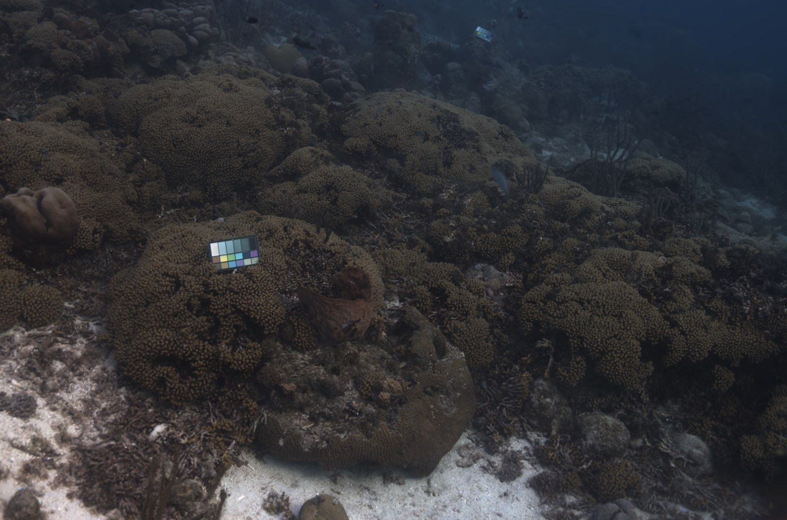

<p align="center">
    <h1 align="center">PEARL<br/><sub>Photometric-Error and Attenuation-Regularized Learning for Underwater 3D Gaussian Splatting</sub></h1>
  <p align="center">
    Thanh-Phuc Nguyen
    ·
    Hoang-Dieu Vu
    ·
    Nhat-Minh Hoang
    ·
    Kien Do
    ·
    Huy-Hieu Pham
  </p>
  <p align="center">
    Phenikaa University · FPT Smart Cloud · VinUni-Illinois Smart Health Center · GREEN-X, VinUniversity
  </p>
  <p align="center">
    <b><i>Paper under review</i></b>
  </p>
</p>
<p align="center">
  
</p>

<p align="justify">
<strong>PEARL</strong> is a medium-aware training framework for underwater 3D Gaussian Splatting, built on top of
<a href="https://github.com/water-splatting/water-splatting">WaterSplatting</a> and
<a href="https://docs.nerf.studio/">nerfstudio</a>. Underwater imagery breaks two assumptions of standard 3DGS
training: photometric error is dominated by wavelength-dependent attenuation and backscatter rather than geometry,
and the usual densification heuristics misallocate the Gaussian budget to regions the medium — not the scene —
fails to explain. PEARL addresses both with two principles:
</p>

- **Principle A — Budgeted residual-driven capacity allocation.** Per-Gaussian photometric error is accumulated by
  residual attribution (an EMA over compositing-weight-normalized residuals) and combined with screen-space activity
  into a densification score. Splitting (along the principal axis), duplication, and pruning all operate under a hard
  budget `N_max`, with complexity-based seeding at initialization.
- **Principle B — Medium-consistent supervision.** Relative L1/SSIM reconstruction losses, edge-aware reweighting,
  a view-conditioned medium MLP (backscatter color, backscatter density, attenuation), depth-dependent Beer-Lambert
  attenuation, and attenuation regularization (magnitude, smoothness, R≥G≥B ordering).

Both principles are independent toggles (`enable_error_densification`, `enable_budget_aware_split`,
`enable_complexity_init`, `enable_edge_loss`, `enable_depth_attenuation`) for ablations.

## Installation

Tested with Python 3.12, PyTorch 2.6.0 + CUDA 12.4, and nerfstudio 1.1.4 on Ubuntu 24.04 (RTX 3090).

```bash
# Environment
conda create --name pearl -y python=3.12
conda activate pearl
python -m pip install --upgrade pip

# PyTorch
pip install torch==2.6.0 torchvision==0.21.0 torchaudio==2.6.0 --index-url https://download.pytorch.org/whl/cu124

# tiny-cuda-nn (needs a CUDA toolkit matching your driver)
pip install ninja git+https://github.com/NVlabs/tiny-cuda-nn/#subdirectory=bindings/torch --no-build-isolation

# nerfstudio
pip install nerfstudio==1.1.4
ns-install-cli

# PEARL (the glm submodule is required to build the CUDA rasterizer)
git clone --recursive <repository-url>
cd PEARL
pip install -e . --no-build-isolation
```

## Data Preprocessing

We follow WaterSplatting and recompute camera parameters with distortion correction using
[COLMAP](https://github.com/colmap/colmap)'s `image_undistorter` on the
[SeaThru-NeRF](https://sea-thru-nerf.github.io/) dataset:

```bash
colmap image_undistorter \
  --image_path data/SeathruNeRF_dataset/IUI3-RedSea/images_wb \
  --input_path data/SeathruNeRF_dataset/IUI3-RedSea/colmap/sparse/0 \
  --output_path data/undistorted_seathrunerf_dataset/IUI3-RedSea \
  --output_type COLMAP
```

## Training

```bash
ns-train pearl --vis viewer+wandb colmap --downscale-factor 1 --colmap-path sparse \
  --data data/undistorted_seathrunerf_dataset/IUI3-RedSea --images-path images
```

Useful flags:

- `--pipeline.model.max-gaussians` — hard budget `N_max` (default 1,000,000).
- `--pipeline.model.enable-error-densification False` etc. — ablate individual PEARL components.
- `ns-train pearl-big ...` — variant without post-densification culling.

The train/test splits follow the SeaThru-NeRF protocol, not the nerfstudio defaults.

## Evaluation

```bash
ns-eval --load-config outputs/unnamed/pearl/<timestamp>/config.yml --render-output-path renders/eval
```

To sweep every saved checkpoint of a run and report the best one per metric:

```bash
python scripts/eval_all_ckpts.py outputs/unnamed/pearl/<timestamp>
```

Robustness studies from the paper (pose-noise sensitivity, medium-mismatch stress, Gaussian-budget ablation) live in
`scripts/`; camera-path generation and offline rendering utilities live in `tools/`.

## Interactive Viewer

```bash
ns-viewer --load-config outputs/unnamed/pearl/<timestamp>/config.yml
```

## Rendering Videos

```bash
ns-render camera-path --load-config outputs/unnamed/pearl/<timestamp>/config.yml \
  --camera-path-filename <camera_path.json> --output-path renders/IUI3-RedSea/pearl.mp4
```

## Citation

The paper is under review; a citation entry will be added upon publication.

```bibtex
@article{nguyen2026pearl,
  title={{PEARL}: Photometric-Error and Attenuation-Regularized Learning for Underwater {3D} Gaussian Splatting},
  author={Nguyen, Thanh-Phuc and Vu, Hoang-Dieu and Hoang, Nhat-Minh and Do, Kien and Pham, Huy-Hieu},
  year={2026},
  note={Under review}
}
```

## Acknowledgements

This codebase is built upon [WaterSplatting](https://github.com/water-splatting/water-splatting)
(Li et al., 3DV 2025), which combines 3DGS with volume rendering for underwater scenes, and inherits its
gsplat-derived CUDA rasterizer. We thank the authors for releasing their code under Apache-2.0.
We also thank the authors of [SeaThru-NeRF](https://sea-thru-nerf.github.io/) for the dataset.

## License

Apache License 2.0 — see [LICENSE](LICENSE). Original WaterSplatting code
Copyright 2024 Huapeng Li, Wenxuan Song, Tianao Xu, Alexandre Elsig and Jonas Kulhanek;
PEARL modifications Copyright 2026 Thanh-Phuc Nguyen et al.
